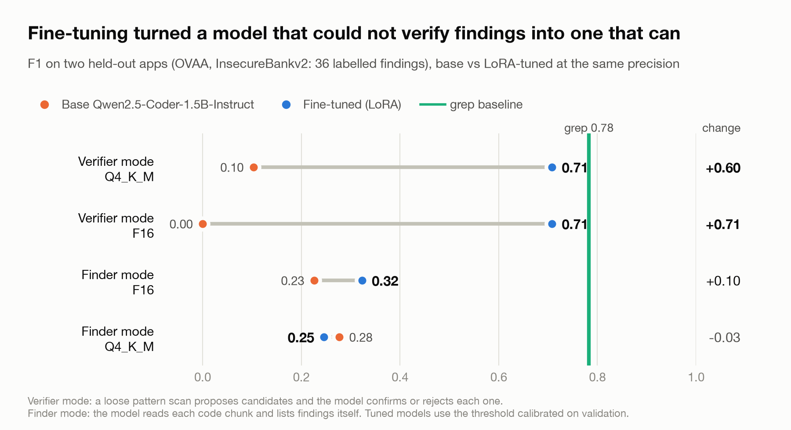
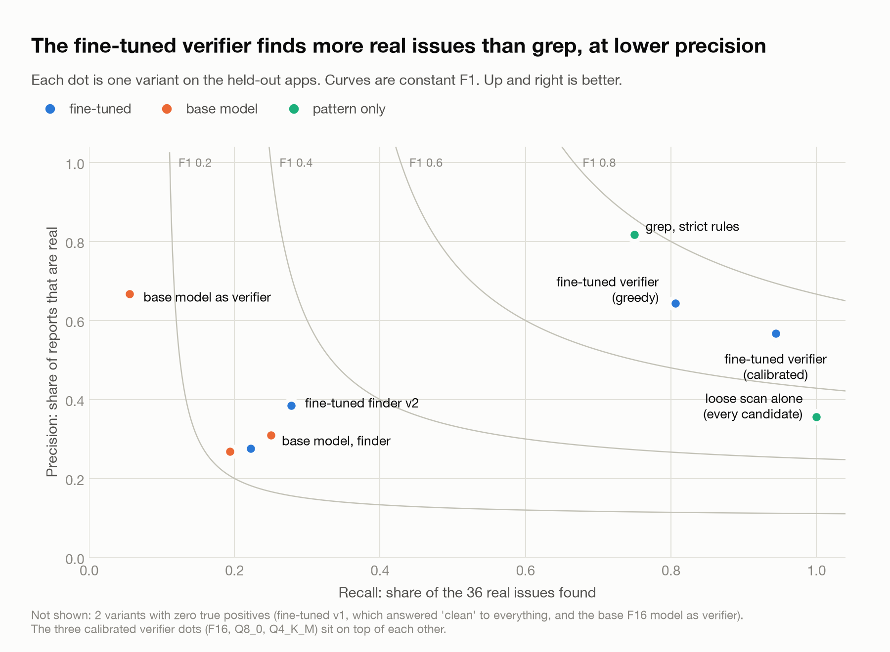
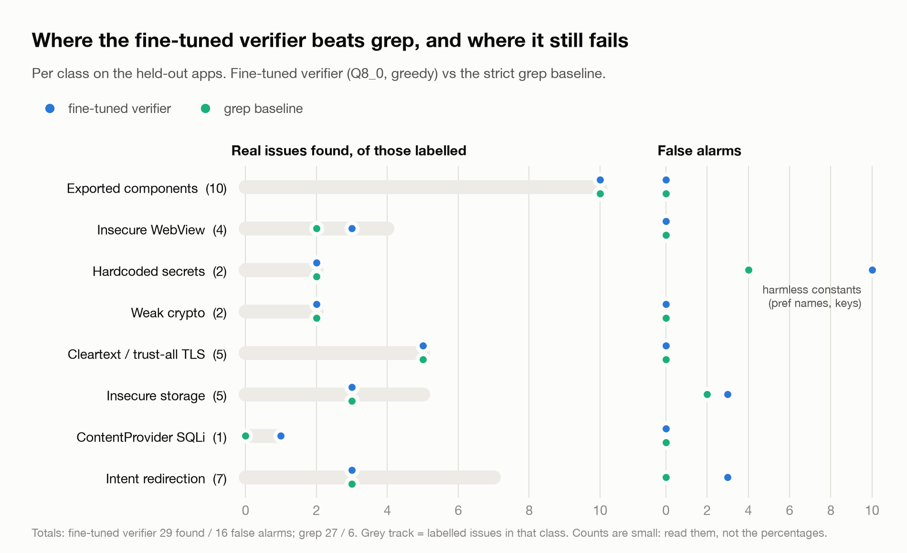
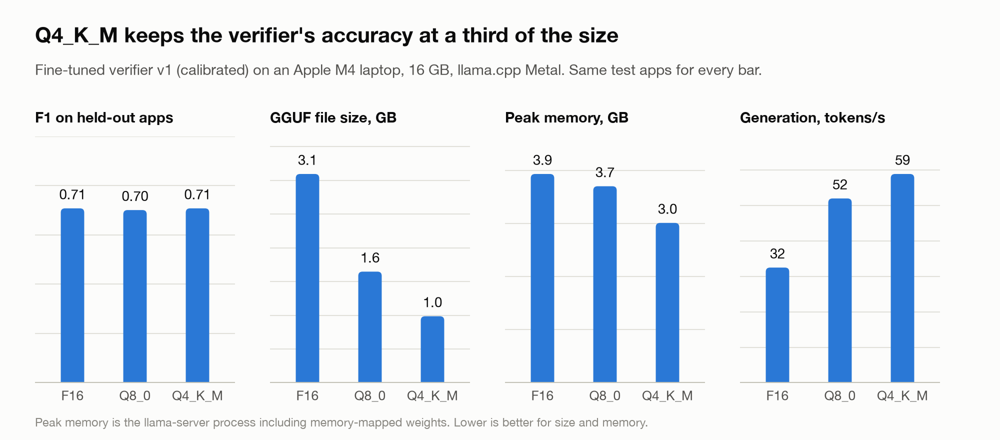
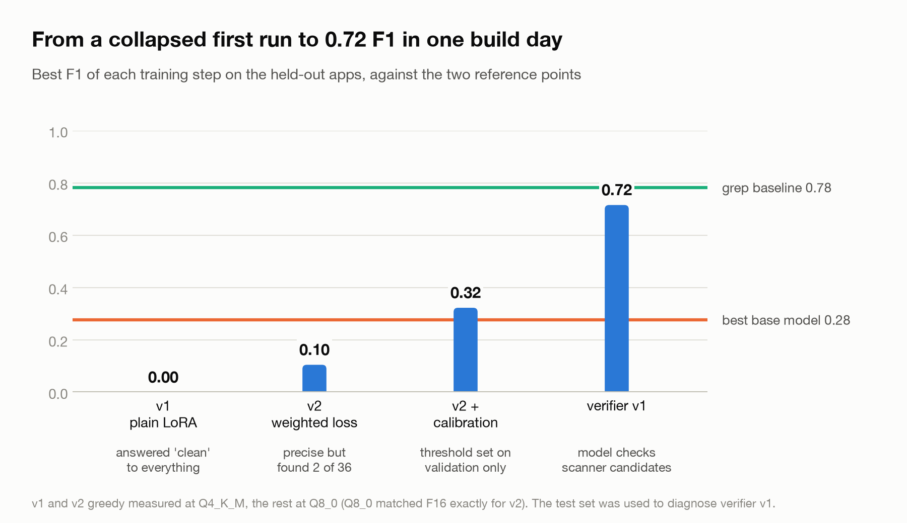

# apkscan-local, by team MNM

**Qwen Local Hackathon 2026 (Qwen Pakistan) entry: offline Android vulnerability triage with a fine-tuned Qwen2.5-Coder-1.5B.**

Team MNM is a one-person team: [iabdullah215](https://github.com/iabdullah215).

This repository is the evidence for the entry: fine-tuning details, the before/after comparison, the reports produced in the demo video, every raw model answer behind every number, the charts, training configs and logs, the ground-truth labels, and a snapshot of the code. The model files are on Hugging Face and the demo video is on YouTube (links below). Every number here is a real measurement on apps the model never saw in training, including what still fails.

| | |
|---|---|
| Base model | [Qwen/Qwen2.5-Coder-1.5B-Instruct](https://huggingface.co/Qwen/Qwen2.5-Coder-1.5B-Instruct), Apache-2.0, revision 2e1fd397 |
| Method | LoRA (rank 16) with MLX-LM, decision-weighted loss, trained on the laptop below |
| Quantization | GGUF Q8_0 (1.6 GB, used in the video) and Q4_K_M (1.0 GB) |
| Runtime | llama.cpp b10210 (`llama-server`, Metal), bound to 127.0.0.1, no network calls |
| Hardware for training and every number | Apple M4 (4P+6E cores), 16 GB unified memory, macOS 27.2.1 |
| Team | MNM (solo): [iabdullah215](https://github.com/iabdullah215) |
| Fine-tuned model (GGUF + LoRA adapter) | Hugging Face: [hwatsauce/apkscan-local](https://huggingface.co/hwatsauce/apkscan-local) |
| Demo video | YouTube: (link pending) |

## The result in one picture

<picture>
  <source media="(prefers-color-scheme: dark)" srcset="result/charts/01-base-vs-tuned-dark.png">
  
</picture>

On two held-out apps (OVAA and InsecureBankv2, 36 hand-labelled vulnerabilities), the untuned Qwen confirms almost nothing. The same model after LoRA finds 29 of 36 at Q8_0, or 34 of 36 at Q4_K_M with the validation-calibrated threshold.

## The model

| File | What it is | Size | Where |
|---|---|---:|---|
| `tuned-verifier-v1-Q8_0.gguf` | fine-tuned verifier, 8-bit, used in the video and the CLI default | 1.6 GB | [Hugging Face](https://huggingface.co/hwatsauce/apkscan-local/blob/main/tuned-verifier-v1-Q8_0.gguf) |
| `tuned-verifier-v1-Q4_K_M.gguf` | same model, 4-bit, same accuracy | 1.0 GB | [Hugging Face](https://huggingface.co/hwatsauce/apkscan-local/blob/main/tuned-verifier-v1-Q4_K_M.gguf) |
| `adapters.safetensors` + `adapter_config.json` | the LoRA adapter itself (MLX format) | 42 MB | [Hugging Face](https://huggingface.co/hwatsauce/apkscan-local/tree/main/lora-adapter) |
| `base-Q8_0.gguf` | untuned Qwen2.5-Coder-1.5B-Instruct, the "before" in the video | 1.6 GB | convert from [Qwen/Qwen2.5-Coder-1.5B-Instruct](https://huggingface.co/Qwen/Qwen2.5-Coder-1.5B-Instruct) |

SHA-256 checksums of these files and of the demo video are in [SHA256SUMS.txt](SHA256SUMS.txt), so the uploaded copies can be checked against the files used for every number here.

Fine-tuning details:

| Setting | Value |
|---|---|
| Base | Qwen2.5-Coder-1.5B-Instruct, revision 2e1fd397 (Apache-2.0) |
| Method | LoRA with MLX-LM 0.32.2, on the M4 laptop (no cloud GPU) |
| LoRA | rank 16, scale 2.0, dropout 0.05; last 16 of 28 transformer blocks; q, k, v, o, gate, up and down projections |
| Loss | answer tokens only, first 5 answer tokens weighted x10 (the real/not-real decision), [training/train_weighted.py](training/train_weighted.py) |
| Data | 1444 verifier examples (685 real, 759 false alarms) from the training apps and the synthetic generator, 141 for validation |
| Schedule | 720 iterations (about 1 epoch), batch 2, learning rate 1.5e-4 constant after 30 warmup steps, max length 1024, seed 0 |
| Training time | 46 min on the Apple M4, 16 GB |
| Validation loss | 1.465 at the start, 0.033 at the end ([training/logs/train-verifier-v1.json](training/logs/train-verifier-v1.json)) |
| Export | fuse, convert with llama.cpp b10210 to GGUF F16, quantize to Q8_0 and Q4_K_M |
| Decision threshold | greedy by default; optional +0.62 logit bias on ` true`, chosen on validation only |

## What is in this repository

```
MNM/
  README.md                 this file
  SHA256SUMS.txt            checksums of the model files and the demo video (hosted on Hugging Face and YouTube)
  LICENSE                   MIT (our code)
  demo/
    video_demo.sh           the exact script that was recorded for the video
    video_helpers.py        prints the tables and findings shown in the video
    demo.sh                 plain one-shot scan (no narration)
  reports/
    video-run/              the reports produced during the recording
      base_report.md/.json      untuned model on OVAA: 0 findings
      tuned_report.md/.json     fine-tuned model on OVAA: 19 findings
    sample_report.md/.json  an earlier run of the same fine-tuned model on OVAA
    finder-v2-2026-11-24/   report from our first design (finder mode), for comparison
  result/
    charts/                 the 5 result charts, light and dark versions
    results.md              full results tables, including per-class F1 for every variant
    runs/<variant>/         metrics.json + predictions.jsonl (every raw model answer) for all 23 evaluated variants
    calibration-*.json      decision thresholds, chosen on the validation set only
  training/
    lora_config_verifier-v1.yaml, lora_config_v2.yaml, lora_config.yaml   MLX-LM LoRA configs
    train_weighted.py       decision-weighted loss (our change to the stock MLX-LM trainer)
    train_mlx.sh, export_gguf.sh   train, fuse, convert, quantize
    logs/                   training and export logs, loss curves, run metadata for v1, v2 and verifier-v1
  data/
    DATA_SOURCES.md         every data source, licence and pinned revision
    labels/                 hand labels; ovaa.yaml and insecurebankv2.yaml are the test-set ground truth
  code/                     snapshot of the apkscan-local source (CLI, scanner, eval harness, data builders, tests)
```

Not included on purpose: model weights and the video (hosted on Hugging Face and YouTube), third-party app code and APKs (re-downloaded by `make data` at pinned commits), and the generated training JSONL. They are reproducible from `code/`.

## The demo video

YouTube: (link pending). It is a screen recording of [demo/video_demo.sh](demo/video_demo.sh), run fully on the M4 laptop. The script narrates each step on screen in yellow `[STEP N]` lines:

1. Hardware (Apple M4, 16 GB) and a network check.
2. The test app (OVAA, held out from training) and the two model files, both Q8_0 and the same size.
3. **The untuned Qwen scans the APK: 0 findings.**
4. **The fine-tuned Qwen scans the same APK, through the same pipeline and the same 43 candidates: 19 findings.**
5. Before vs after.
6. Two findings in full: a JavaScript WebView loading `file://` URLs, and a hardcoded AES key.
7. The measured results table on both held-out apps.
8. What still fails: `PASSWORD_KEY = "password"` wrongly flagged as a secret.

The reports it produced are in [reports/video-run/](reports/video-run/):

| | Model | Candidates | Findings | Model time |
|---|---|---:|---:|---:|
| Before | `base-Q8_0.gguf` (untuned) | 43 | **0** | 26.7 s |
| After | `tuned-verifier-v1-Q8_0.gguf` (LoRA) | 43 | **19** (10 high, 9 medium) | 51.8 s |

Why the base model reports nothing: it answered `{"real": false}` (inside a Markdown code fence, so never strict JSON) for **every one of the 129 candidates** in both test apps, all 43 in OVAA included. Raw answers: [result/runs/verifier-base-Q8_0-shortprompt/predictions.jsonl](result/runs/verifier-base-Q8_0-shortprompt/predictions.jsonl). That run uses the same short prompt the CLI used in the video. With a longer prompt that spells out the task (the "full" prompt, used for the base rows in the results table) the base model still finds 0 of 36 at F16 and 2 of 36 at Q4_K_M.

## How the tool works

```
app.apk -> jadx decompile -> app files only (libraries skipped), original line numbers kept
        -> loose pattern scanner: every suspicious line becomes a candidate (high recall, mostly false alarms)
        -> fine-tuned Qwen verifier via llama-server on 127.0.0.1: {"real": true/false, severity, cwe, evidence, why, fix}
        -> confirmed findings -> JSON + Markdown report
```

It covers 8 classes: exported components, insecure WebView, hardcoded secrets, weak crypto, cleartext or trust-all TLS, insecure storage, ContentProvider SQL injection and intent redirection, each mapped to a CWE and an OWASP MASVS v2 control. It explains and suggests fixes; it never writes exploits.

## Results on held-out apps

Test set: OVAA 1.0.0 and InsecureBankv2, decompiled from their APKs. They were never used in training. 129 candidates, 36 labelled findings. Temperature 0. Source files: `result/runs/*/metrics.json`.

| Variant | F1 | Precision | Recall | Found / FP / Missed | Strict JSON | GGUF | Peak RAM | Gen tok/s |
|---|---:|---:|---:|---|---:|---:|---:|---:|
| grep baseline, strict rules | 0.78 | 0.82 | 0.75 | 27 / 6 / 9 | n/a | n/a | n/a | n/a |
| loose scanner alone (every candidate) | 0.53 | 0.36 | 1.00 | 36 / 65 / 0 | n/a | n/a | n/a | n/a |
| Base Qwen, F16, full prompt | 0.00 | 0.00 | 0.00 | 0 / 1 / 36 | 2% | 3.1 GB | 4.7 GB | 28 |
| Base Qwen, Q8_0, short prompt (as in the video) | 0.00 | 0.00 | 0.00 | 0 / 0 / 36 | 0% | 1.6 GB | 3.4 GB | 60 |
| Base Qwen, Q4_K_M, full prompt | 0.10 | 0.67 | 0.06 | 2 / 1 / 34 | 2% | 1.0 GB | 2.7 GB | 61 |
| **Fine-tuned, Q8_0** (video, CLI default) | **0.72** | 0.64 | 0.81 | 29 / 16 / 7 | 97% | 1.6 GB | 3.5 GB | 49 |
| Fine-tuned, F16, calibrated | 0.71 | 0.57 | 0.94 | 34 / 26 / 2 | 96% | 3.1 GB | 3.9 GB | 32 |
| Fine-tuned, Q8_0, calibrated | 0.70 | 0.56 | 0.94 | 34 / 27 / 2 | 97% | 1.6 GB | 3.7 GB | 52 |
| Fine-tuned, Q4_K_M, calibrated | 0.71 | 0.57 | 0.94 | 34 / 26 / 2 | 99% | 1.0 GB | 3.0 GB | 59 |

"Calibrated" adds a logit bias of +0.62 on the ` true` token, chosen on the validation set only ([result/calibration-verifier-v1.json](result/calibration-verifier-v1.json)). It trades precision for recall. Peak RAM is the llama-server process including memory-mapped weights.

What this shows:

- **The fine-tune helped, a lot.** F1 went from 0.00 to 0.71 at F16, 0.00 to 0.72 at Q8_0 and 0.10 to 0.71 at Q4_K_M. Strict JSON went from 0 to 2% up to 96 to 99%.
- **Quantization costs nothing.** Q4_K_M matches F16 at a third of the size and runs in 3 GB of RAM.
- **grep still has the higher F1** (0.78 vs 0.72). The model finds more real issues than grep (recall up to 0.94 vs 0.75) but raises more false alarms. The grep rules and the labels were written by the same person, which favours grep. Only the model explains each finding and gives a fix.
- **The test set is small** (36 findings), so differences of a few points are noise. Read the raw counts.

<picture>
  <source media="(prefers-color-scheme: dark)" srcset="result/charts/02-precision-recall-dark.png">
  
</picture>

<picture>
  <source media="(prefers-color-scheme: dark)" srcset="result/charts/03-per-class-dark.png">
  
</picture>

<picture>
  <source media="(prefers-color-scheme: dark)" srcset="result/charts/04-quantization-dark.png">
  
</picture>

More tables (finder mode, APK versus source input, per-class F1 for every variant): [result/results.md](result/results.md).

## Before and after on one held-out candidate

InsecureBankv2 `TrackUserContentProvider.java` line 78 passes the caller's projection, selection and sort order straight into `SQLiteQueryBuilder.query`. It is a real, labelled SQL injection, and grep misses it.

Base Qwen (F16), from [result/runs/verifier-base-F16/predictions.jsonl](result/runs/verifier-base-F16/predictions.jsonl):

````
```json
{
  "real": false
}
```
````

Fine-tuned (Q8_0), from [result/runs/verifier-v1-Q8_0-greedy/predictions.jsonl](result/runs/verifier-v1-Q8_0-greedy/predictions.jsonl):

```json
{"real": true, "severity": "high", "cwe": "CWE-89",
 "evidence": "caller projection, selection and sortOrder passed to SQLiteQueryBuilder.query without setStrict or a projection map",
 "why_exploitable": "A calling app controls part of the SQL, so it can read rows or tables beyond user data (for example with UNION SELECT or a subquery in the selection).",
 "fix": "Use parameterized selections with selectionArgs, a fixed projection map, qb.setStrict(true) and setStrictColumns, and require a permission on the provider."}
```

## What still fails

These are real outputs, checked against the labels in [data/labels/ovaa.yaml](data/labels/ovaa.yaml):

- **False alarms on harmless constants.** 10 of the 16 test-set false positives are `hardcoded_secret` on strings like `MYPREFS2 = "mySharedPreferences"` or a password-policy regex. In the video: `PASSWORD_KEY = "password"`.
- **Launcher activity flagged.** `EntranceActivity` is reported as an exported component, but it is the app's launcher and must be exported.
- **Wrong class accepted.** The exported `InsecureLoggerService` is confirmed as `hardcoded_secret`. The scanner proposes the class and the model accepted it.
- **Missed intent redirection.** 4 of the 7 misses are OVAA deep-link and broadcast flows that need reasoning beyond a 20-line window.
- **Test set used for diagnosis.** The verifier numbers are its first evaluation. The error analysis above then looked at the test predictions, so a next version must be checked on a separate dev app.

Treat output as triage leads for a human reviewer.

## How we got here

<picture>
  <source media="(prefers-color-scheme: dark)" srcset="result/charts/05-journey-dark.png">
  
</picture>

1. **v1, plain LoRA, "finder" (the model reads whole code chunks): F1 0.00.** The loss went down, but the model answered "clean" to every input. The clean-or-not decision is one token out of about 140, so the model learned the format but not the decision.
2. **v2, decision-weighted loss** ([training/train_weighted.py](training/train_weighted.py), first answer token x10): F1 0.10. It became precise but found only 2 of 36.
3. **v2 plus a threshold calibrated on validation only:** F1 0.32, above the best base model (0.28).
4. **Verifier v1:** the task was split so the scanner proposes and the model decides. Training data was labelled automatically from the training apps, 1444 candidates (685 real, 759 false), with the first 5 answer tokens weighted. Result: F1 0.72.

| Run | Data | Iterations | Batch | LR | Time on the M4 | Final val loss |
|---|---|---:|---:|---|---:|---:|
| finder v2 | 780 records | 600 | 2 | 1.5e-4 | 59 min | 0.101 |
| verifier v1 (shipped) | 1444 candidates | 720 | 2 | 1.5e-4, 30 warmup | 46 min | 0.033 |

Both runs: LoRA rank 16, scale 2.0, dropout 0.05, last 16 of 28 blocks, all attention and MLP projections, loss on the answer only, seed 0, MLX-LM 0.32.2. Logs are in [training/logs/](training/logs/).

## Data

Details: [data/DATA_SOURCES.md](data/DATA_SOURCES.md).

| Source | Licence | Use |
|---|---|---|
| OVAA 1.0.0, InsecureBankv2 (APKs) | BSD-2-Clause, MIT | **test only**, every file labelled by hand |
| DIVA, allsafe, InjuredAndroid (source) | GPL-3.0, Apache-2.0, Apache-2.0 | training |
| OWASP MASTG demos (24) | CC-BY-SA-4.0 | training |
| Synthetic generator (ours) | MIT | training and validation, rule-checked |
| AndroGoat | no licence | excluded |

The split is by app, never by snippet, and a unit test checks that no test-app text appears in the training data. No personal data is used: the "credentials" in these apps are fake demo values.

## How to verify

**Check the downloaded model files.** Download the GGUF files and the adapter from [Hugging Face](https://huggingface.co/hwatsauce/apkscan-local) and compare their SHA-256 with [SHA256SUMS.txt](SHA256SUMS.txt):
```bash
shasum -a 256 tuned-verifier-v1-Q8_0.gguf tuned-verifier-v1-Q4_K_M.gguf adapters.safetensors
```

**Re-run the video demo** (macOS on Apple Silicon, `brew install jadx llama.cpp`, Python 3.12 with uv). The scripts expect the full project layout, so run them from the project repo (snapshot in [code/](code/)):
```bash
cd apkscan-local
make setup && make data                      # env from uv.lock; APKs and sources at pinned commits
# put the Hugging Face GGUF files in models/gguf/; base-Q8_0.gguf comes from the base model:
#   train/export_gguf.sh models/base/Qwen2.5-Coder-1.5B-Instruct models/gguf/base
demo/video_demo.sh                           # FAST=1 to skip the typing effect
```

**Run the tool alone,** on any machine with llama.cpp and jadx:
```bash
apkscan-local scan app.apk --model tuned-verifier-v1-Q4_K_M.gguf --md report.md --out report.json
```

**Re-score any variant** from its saved raw answers: `result/runs/<variant>/predictions.jsonl` holds every model answer, and `code/eval/` holds the scorer.

## Limits

- 8 vulnerability classes only. Deserialization, path traversal and logging are not covered.
- Tested on deliberately vulnerable demo apps, not on obfuscated real-world release builds.
- Two test apps, 36 findings.
- The model only sees what the loose scanner flags. On the test apps that was 100% of labelled issues.

## Licence

Our code is MIT. The base model is Apache-2.0 (Qwen). The data keeps its original licences (see [data/DATA_SOURCES.md](data/DATA_SOURCES.md)).
